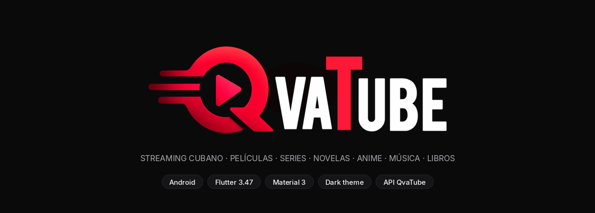
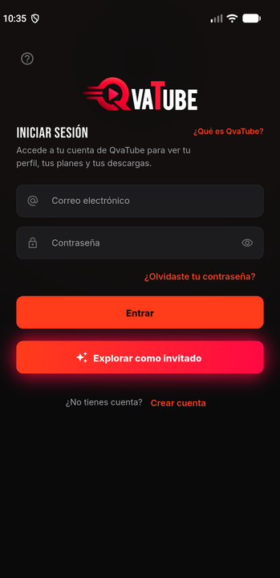
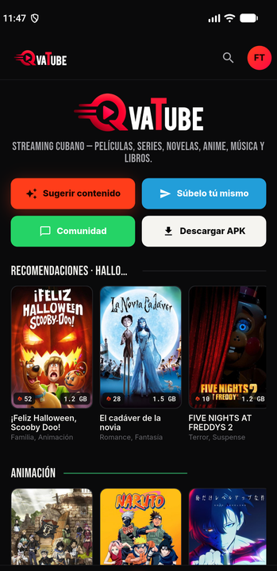
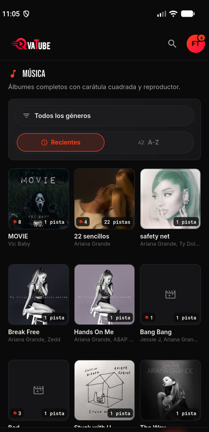
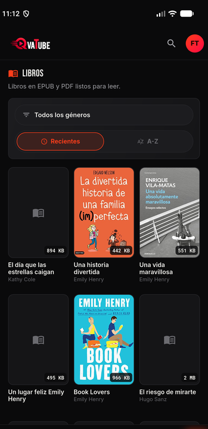

<div align="center">



# QvaTube — App Android

**Streaming cubano — películas, series, novelas, anime, música y libros en un solo lugar, hecho para Cuba.**

[](https://github.com/R0ger0l1va/qvatube_apk/releases/latest)
[](https://docs.flutter.dev)
[](https://developer.android.com)

[](LICENSE)

[**⬇ Descargar la APK**](https://github.com/R0ger0l1va/qvatube_apk/releases/latest/download/qvatube.apk) ·
[**⬇ Todas las versiones**](https://github.com/R0ger0l1va/qvatube_apk/releases)

</div>

---

> Este repositorio es únicamente de **distribución**: aquí se publican los APK oficiales de QvaTube. El código fuente es privado.

## 📱 Qué es esta app

QvaTube es el cliente **Android nativo** de la plataforma de streaming QvaTube. Lleva
el catálogo completo (casi 20.000 títulos) a un teléfono con pantalla pequeña y conexiones
lentas: tema oscuro cinematográfico, un solo color de acento, tipografías condensadas y
descargas optimizadas para gastar lo mínimo de datos.

<div align="center">




</div>

---

## ✨ Funcionalidades

| | Pantalla | Qué hace |
|---|---|---|
| 🔐 | **Introducción** | Se muestra **solo la primera vez**: resumen de la app, logo y opción de cerrar. |
| 🔐 | **Login / Registro** | Email + contraseña, recuperación por Telegram, OTP de 6 casillas, modo invitado y vinculación con Telegram. |
| 🏠 | **Inicio** | Hero con acciones rápidas, carruseles de "Seguir donde quedaste", recomendaciones de temporada y filas por género. |
| 🔥 | **Popular** | Lo más visto de la comunidad, con cinta "NUEVO" y contador de popularidad. |
| 📺 | **Televisión** | Canales en vivo (pendiente de endpoint en el backend). |
| 🎬 | **Películas / Series / Anime / Novelas** | Catálogo completo con filtro por género, orden Recientes/A-Z y scroll infinito. |
| 🎵 | **Música** | Álbumes con carátula cuadrada, artista y número de pistas. |
| 📖 | **Libros** | Libros en EPUB/PDF con portada y tamaño del archivo. |
| 👤 | **Mi perfil** | Datos de la cuenta, plan, código de referido, foto de perfil y vinculación con Telegram. |
| 💳 | **Plan y suscripción** | Consumo del plan (descargas, streams, música) y catálogo de planes CUP/USD. |
| 🔔 | **Notificaciones** | Avisos de la cuenta, marcar como leídas y borrar. |
| ❤️ | **Favoritos** | Contenido guardado por el usuario. |
| 💬 | **Comunidad** | Enlace a WhatsApp, bot de Telegram y datos de pago por Transfermóvil. |
| ⚙️ | **Configuración** | Preferencias locales (cinta "NUEVO", fila "Seguir donde quedaste"). |

### ⬆️ Autoactualización

La app comprueba al abrirse si hay una **versión nueva publicada en GitHub**
(manifiesto de 1 KB) y, si la hay, muestra una banda con el aviso, **descarga
el APK y abre el instalador del sistema** para actualizar sin salir de QvaTube.

Además: *Configuración → Buscar actualizaciones* hace una comprobación
profunda (descarga el APK y lee su `versionCode`).

---

## ⬇️ Cómo obtener la APK (paso a paso)

Cada nueva versión se publica automáticamente en una release con el APK firmado.
El enlace **siempre** apunta a la última versión:

### Opción 1 — desde el navegador (la más fácil)

1. Abre la sección **Releases** del repositorio:
   👉 https://github.com/R0ger0l1va/qvatube_apk/releases
2. En **"QvaTube (última versión)"** descarga el archivo **`qvatube.apk`** (~26 MB).
   - Es el APK de release **solo arm64-v8a** (Android 7+ de 64 bits, el 99 % de
     los teléfonos activos), minificado con R8 y con el código de Dart ofuscado.
3. En el teléfono, abre el archivo descargado y acepta **"Instalar apps de orígenes
   desconocidos"** para tu navegador o gestor de archivos.
4. Listo: QvaTube aparece en el launcher con el icono de la marca.

### Opción 2 — enlace directo (ideal para compartir)

Copia y pega este enlace; siempre descarga la última versión publicada:

```
https://github.com/R0ger0l1va/qvatube_apk/releases/latest/download/qvatube.apk
```

Puedes ponerlo en la web, en un grupo de Telegram o en el botón **"Descargar APK"** de la
propia app.

### Opción 3 — desde la terminal

```bash
# Bajar el APK a tu ordenador
curl -L -o qvatube.apk \
  https://github.com/R0ger0l1va/qvatube_apk/releases/latest/download/qvatube.apk

# Instalarlo en un teléfono conectado por USB
adb install -r qvatube.apk
```

---

## 🗺️ Hoja de ruta

- [x] Autenticación completa (login, registro, recuperación y verificación por Telegram)
- [x] Catálogo por categorías con filtros, orden y paginación
- [x] Home con datos reales (recomendaciones, géneros, estadísticas, reseñas)
- [x] Perfil, plan, notificaciones, favoritos y comunidad
- [x] Barra inferior de 9 secciones con Inicio en el medio
- [x] Autoactualización desde la app (aviso, descarga e instalación)
- [ ] Reproductor de video, música y libros
- [ ] Descargas con autorización
- [ ] Progreso de reproducción y "marcar como visto"
- [ ] Canales de TV en vivo (hace falta un endpoint de canales)
- [ ] Temas descargables (nuevas temporadas desde el servidor)
- [ ] Notificaciones push y catálogo offline

---

## 📄 Licencia

GPL-3.0 · Hecho con 🧡 para Cuba.
